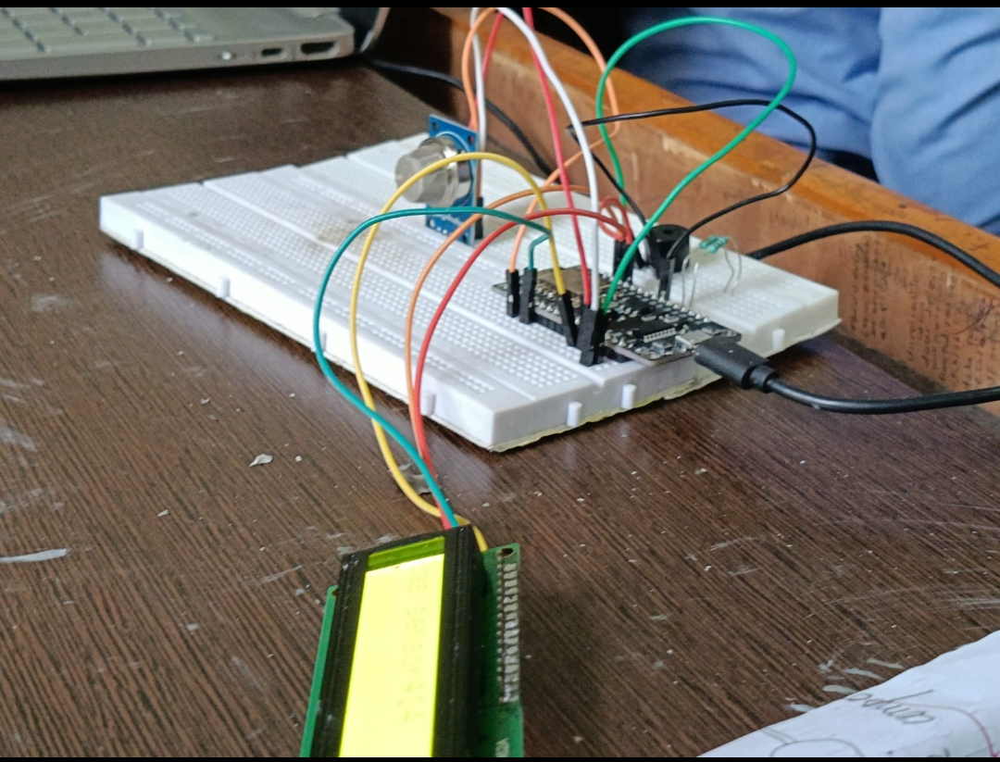
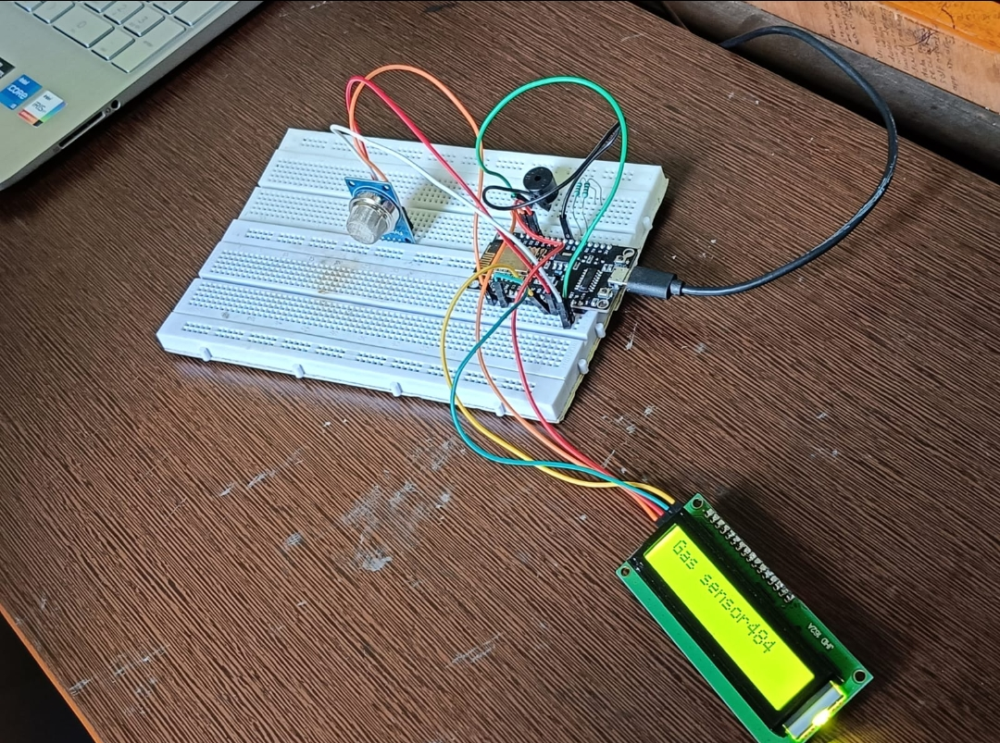

# Smart Gas Estimation and Alert Module

An embedded systems project designed to monitor gas levels, identify unsafe gas concentrations, and generate alerts using gas sensors and a microcontroller.

## Project Overview

The Smart Gas Estimation and Alert Module is a sensor-based gas monitoring system developed using MQ gas sensors and an Arduino/ESP32 microcontroller.

The system monitors gas levels using MQ-2/MQ-6 sensors. It processes sensor readings to identify gas concentrations that exceed a predefined safety threshold and activates a buzzer to alert users.

## Project Objectives

- Monitor gas levels using MQ-2/MQ-6 gas sensors.
- Identify unsafe gas concentrations through threshold detection.
- Provide alerts when gas levels exceed the defined threshold.
- Demonstrate sensor interfacing and microcontroller-based monitoring.
- Support gas safety monitoring through an embedded system.

## Hardware Components

| **Component** | **Purpose** |
|---|---|
| Arduino / ESP32 | Main controller for the system |
| MQ-2 Gas Sensor | Detects combustible gases and smoke |
| MQ-6 Gas Sensor | Detects LPG and other combustible gases |
| Buzzer | Provides an audible alert |
| Connecting Wires | Establish electrical connections |
| Power Supply | Supplies power to the system |

## Software and Technologies

- Embedded C / Arduino C++
- Arduino IDE
- Arduino / ESP32
- MQ Gas Sensors
- Sensor Interfacing
- Threshold-Based Detection

## System Working

1. **System Initialization:** The microcontroller initializes the gas sensors and buzzer.
2. **Gas Monitoring:** The MQ-2/MQ-6 sensors continuously monitor gas levels.
3. **Sensor Readings:** The sensors provide readings to the microcontroller.
4. **Threshold Comparison:** The microcontroller compares the sensor readings with a predefined threshold.
5. **Gas-Level Detection:** The system identifies whether the detected gas level exceeds the defined threshold.
6. **Alert Generation:** When an unsafe gas level is detected, the buzzer is activated to alert users.
7. **Continuous Monitoring:** The system continues monitoring gas levels and responds to changes in sensor readings.

## Project Features

- Real-time gas-level monitoring
- MQ-2/MQ-6 sensor interfacing
- Threshold-based gas detection
- Buzzer-based safety alerts
- Microcontroller-based monitoring
- Embedded hardware and software integration

## Block Diagram

```text
       MQ-2 Gas Sensor
              |
              |
       MQ-6 Gas Sensor
              |
              v
       Arduino / ESP32
              |
              v
       Threshold Checking
              |
              v
       Gas-Level Detection
              |
              v
           Buzzer
         (Gas Alert)
```

## Applications

- Gas leakage monitoring
- Domestic gas safety systems
- LPG leakage detection
- Industrial gas monitoring prototypes
- Embedded safety monitoring systems

## Limitations

- Detection accuracy depends on sensor calibration and environmental conditions.
- Sensor readings may vary depending on gas concentration and surrounding conditions.
- Threshold values need to be configured and tested for the intended application.
- The system is an academic prototype and is not a certified industrial safety device.

## Future Improvements

- Add an LCD or display for real-time gas readings.
- Integrate GSM or IoT-based remote notifications.
- Develop a mobile or web dashboard for monitoring gas levels.
- Improve gas detection accuracy through sensor calibration.
- Explore gas consumption estimation and data logging.

## Project Images

Add photographs of the actual hardware setup, sensor connections, and circuit diagram here.


### Project Hardware Setup


### Circuit and Connections


### Project Demonstration



## Conclusion

This project demonstrates the integration of embedded systems, gas sensors, and microcontroller-based monitoring for gas-level detection and safety alerts. It provides a foundation for developing improved gas monitoring solutions with real-time detection and alert mechanisms.

---

**Project Domain:** Embedded Systems | Internet of Things (IoT) | Sensor-Based Monitoring

**Controller:** Arduino / ESP32

**Sensors:** MQ-2 / MQ-6 Gas Sensors

**Programming:** Embedded C / Arduino C++
